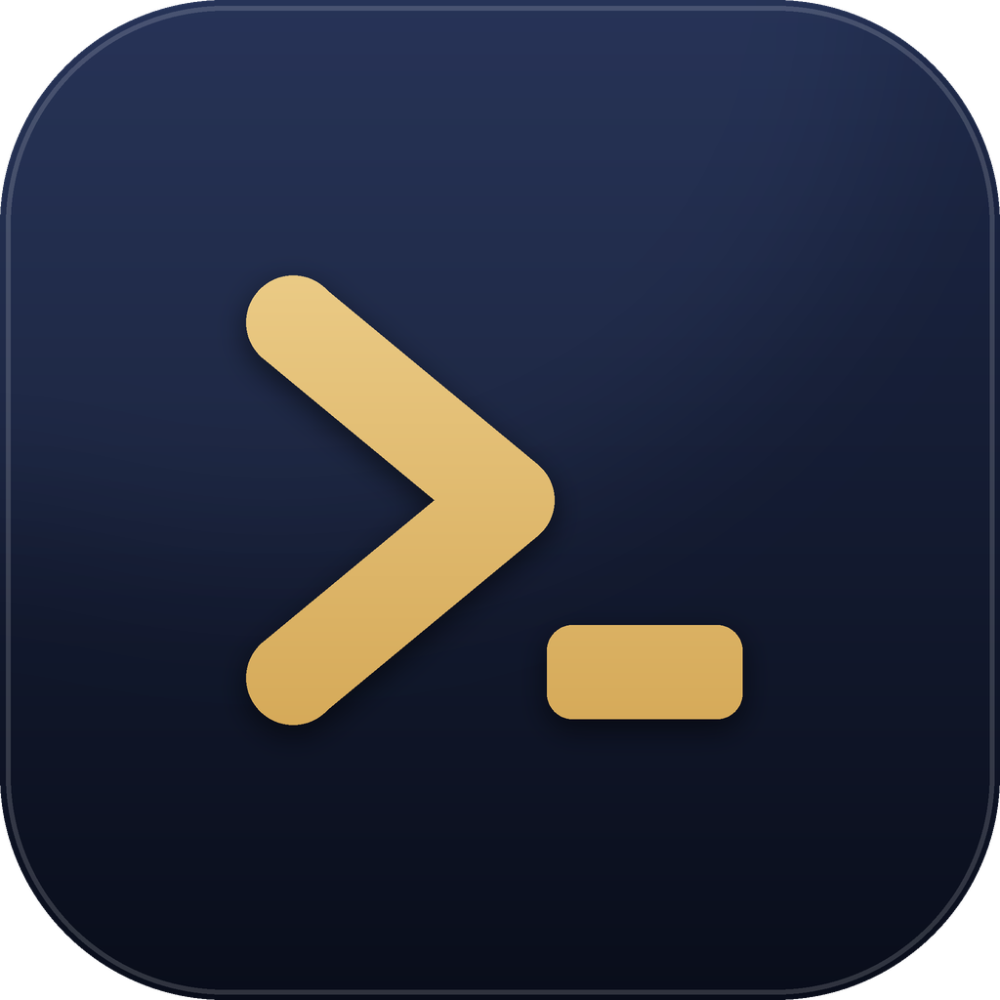

<p align="center"></p>

# PocketShell (포켓쉘)

PC(Windows)의 터미널 세션을 Android 폰에서 같은 색상(24bit)·TUI 그대로 보고 입력하는 도구.
PC 호스트가 ConPTY로 셸을 소유하고 원본 VT 스트림을 폰(네이티브 Termux 엔진)과 PC(Windows Terminal 탭)에 동시에 보냄.
PC에서 직접 띄운 터미널과 Claude/GPT(codex)가 돌고 있는 콘솔도 폰에서 열 수 있음.

## 주요 기능
- **폰에서 PC 터미널 그대로**: 24bit 색·TUI·한글 조합 입력, 외부 콘솔은 폰 폭에 맞춰 다시 배치, 지난 기록 스크롤·검색·복사
- **Claude/GPT 작업 알림**: 입력 대기·끝남을 폰 알림으로 받고, 알림에서 선택지·답장으로 바로 응답
- **프로젝트 관리**: 폰에서 새 프로젝트(폴더 + claude/codex 실행), 세션 종료·삭제, 세션과 폴더 삭제(대화 기록까지 PC 휴지통으로)
- **입력 도우미**: 빠른 응답 버튼, 자주 쓰는 문구, 음성 입력, 사진 첨부(Claude Code), 프로젝트 파일 보기·업로드·다운로드
- **여러 PC**: PIN 페어링, LAN·Tailscale 자동 선택, PC별 상태 한눈에
- **자동 업데이트**: PC 앱·폰 앱 모두 GitHub Releases에서 확인, 진행 상황 표시

## 구성
| 경로 | 내용 |
|---|---|
| `host/src/PocketShell.Tray` | 트레이 앱 `PocketShell.exe` — 서버를 백그라운드로 실행·중지, 휴대폰 연결(PIN), 로그인 시 자동 실행 |
| `host/src/Pkshell` | 서버 + CLI `psh.exe` (`psh serve`, `psh attach` …) |
| `android/` | Kotlin Android 앱 `com.neststudio.pocketshell` (Termux terminal-emulator/view 기반, Apache-2.0) |
| `qa/Pkshell.QA` | E2E QA 드라이버 |
| `installer/PocketShell.iss` | Windows 원클릭 설치 파일(Inno Setup) 스크립트 |
| `assets/` | 아이콘 (`scripts/make_icons.py`로 생성) |
| `docs/DESIGN.md` | 프로토콜/구조 계약 |

## 빠른 시작
1. PC: [Releases](../../releases/latest)에서 `PocketShell-Setup-v*.exe`를 받아 실행 (원클릭 설치)
   - `%LOCALAPPDATA%\Programs\PocketShell`에 설치(관리자 권한 불필요), 시작 메뉴 등록. .NET 8 Desktop + ASP.NET Core 런타임이 없으면 Microsoft에서 받아 설치함(이때만 관리자 권한 확인).
   - 서명되지 않은 파일이라 Windows가 "PC 보호" 창을 띄우면 **추가 정보 → 실행**.
   - 제거: Windows 설정 → 앱 → PocketShell. 데이터(`%APPDATA%\PocketShell`)는 물어보고 지움.
   - 수동 설치: `pocketshell-host-win-x64-*.zip`을 풀고 `PocketShell.exe` 실행 (런타임은 직접 설치).
2. 설치가 끝나면 트레이 아이콘이 생기고 서버가 백그라운드에서 실행됨 (포트 7380, LAN·Tailscale·루프백에만 바인딩, TLS). 휴대폰 연결 (PIN) 창이 바로 열리고, Windows 로그인 시 자동 실행이 켜짐
3. 트레이 아이콘 더블클릭 또는 메뉴 **휴대폰 연결 (PIN)** → 6자리 PIN과 인증서 지문 표시
4. 폰: `pocketshell-android-*.apk` 설치 → **PC 추가** → 이 PC 선택(또는 IP 입력) → PIN 입력 → 지문 확인
5. 폰에서 세션 목록 선택 또는 새 세션 생성 → PC에는 Windows Terminal 탭이 자동으로 열림

트레이 메뉴: 서버 시작/중지, 휴대폰 연결 (PIN), 프로젝트 폴더, 데이터·로그 폴더 열기, Windows 시작 시 자동 실행, 종료(서버도 중지).
**프로젝트 폴더…**: 폰에서 새 프로젝트를 만들 상위 폴더를 추가·삭제(여러 개 가능, `%APPDATA%\PocketShell\projects.json`). 이 PC에서 찾은 AI CLI(claude, codex)도 표시됨.
서버가 예기치 않게 꺼지면 트레이가 다시 띄움(5분에 최대 3회).

PC CLI: `psh list`, `psh new`, `psh attach <id>` (분리: `Ctrl+]` 후 `d`), `psh pair`, `psh devices`, `psh revoke <id>`, `psh update [--check] [--force [--kill-working]]`, `psh firewall-cleanup [--list]`
- 업데이트는 실행 중인 세션을 끝내므로, 세션이 있으면 끝날 세션 목록을 보여 주고 다시 물음(`--force`). AI가 작업 중인 세션이 있으면 한 번 더 물음(`--kill-working`). 트레이와 폰도 같음.
- `psh firewall-cleanup`: 예전 설치(이전 이름 mpta 포함)와 지워진 실행 파일이 남긴 Windows 방화벽 규칙을 지움. `--list`는 목록만. 지울 때 관리자 권한 확인 창이 뜸.

## 폰 앱 사용법

**PC 목록 (첫 화면)**
- 앱을 열면 연결한 PC 목록이 나옴. PC는 여러 대 연결 가능. 카드마다 연결 상태(연결됨·버전 / 연결 안 됨)와 주소 표시.
- PC를 누르면 그 PC의 세션 목록으로 들어감. 세션 목록 왼쪽 위 뒤로가기(←)로 PC 목록에 돌아옴.
- **PC 추가**: 다른 PC를 PIN으로 연결. 같은 PC를 다시 연결하면 기존 항목을 갱신함.
- PC 카드의 ⋮(또는 길게 누르기) → **별칭 설정** / 연결 해제. 별칭은 목록과 세션 화면에 PC 이름 대신 표시되고, PC 이름은 주소 줄에 함께 나옴. 비우면 PC 이름으로 돌아감.
- 메뉴 **다른 PC에 설치하는 방법**: 설치 순서와 다운로드 페이지(GitHub Releases) 링크.
- PC가 나중에 주소를 추가하면(예: Tailscale을 켬) 목록을 열 때 자동으로 저장함.

**작업 알림 (Claude/GPT가 멈추면 폰에 알림)**
- PC의 Claude/GPT가 **승인을 기다리거나**(입력 대기) **작업을 끝내면** 폰에 알림이 옴. 앱을 닫아 둬도 옴.
- 입력 대기 알림에는 선택지 버튼이 붙어서 알림에서 바로 고를 수 있음. 선택지가 4개 이상이면 앞의 2개와 **선택지 n개 보기**(세션을 열어 전부 표시).
- 끝남 알림에는 Claude/GPT가 마지막에 쓴 내용이 보이고, **답장**과 자주 쓰는 문구 칩으로 다음 지시를 바로 보낼 수 있음. 알림을 누르면 그 세션이 열림.
- **이 세션 알림 끄기**: 끝남 알림의 버튼 또는 터미널 ⋮ 메뉴. 다시 켜는 것은 터미널 ⋮ 메뉴.
- PC 목록 메뉴 **방해 금지 시간**: 정한 시간대에는 알림이 소리·팝업 없이 옴(기본 23:00~07:00, 꺼져 있음).
- PC 목록 메뉴 **작업 알림 끄기/켜기**. 켜져 있는 동안 "작업 알림 대기 중" 고정 알림이 표시됨(폰이 PC에 직접 물어보는 방식이라 필요함). 고정 알림에 연결 상태가 나옴: "PC n대 연결됨", 또는 "연결 안 됨: 이름"(그 PC의 알림은 못 받는 상태).
- 폰과 PC가 연결돼 있을 때만 옴(같은 Wi-Fi 또는 Tailscale). 폰을 오래 그대로 두면 절전 때문에 늦을 수 있어, 처음 켤 때 배터리 최적화 제외를 안내함.
- PC에서 터미널 창을 앞에 두고 키보드·마우스를 쓰는 동안에는 그 PC의 외부 콘솔은 추적하지 않음(직접 보고 있으므로).
- 판정 방식: 화면이 계속 바뀌면 작업 중, 멈췄는데 선택지(❯ 표시)가 떠 있으면 입력 대기, 아니면 끝남. 문구가 아니라 화면 변화로 보므로 Claude/GPT 버전이 바뀌어도 동작함.

**세션 목록**
- 카드에 Claude/GPT 상태가 표시됨: **작업 중 / 입력 대기 / 끝남** (5초마다 갱신). PC 목록 카드에는 PC별 합계(입력 대기 n · 작업 중 n · 끝남 n).
- **실행 중**: 폰이나 `psh new`로 만든 PocketShell 세션.
- **외부**: PC에서 직접 띄운 터미널(Windows Terminal, 탐색기, VS Code·Cursor·JetBrains 등)과 Claude/GPT(codex)가 돌고 있는 콘솔만 표시. 항목에는 `Claude`/`GPT` 표시와 폴더만 나옴. 제목이 `C:\WINDOWS\System32\cmd.exe`인 빈 cmd 창은 안 나옴(최근에도).
- **최근**: 끝난 세션 기록, 최근 활동 순. 누르면 같은 폴더·셸로 다시 시작하고, Claude/GPT가 돌던 세션이면 그 폴더의 마지막 대화를 이어감.
  - 한 폴더는 화면에 한 번만: 실행 중·외부에 열려 있는 폴더는 안 나오고, 같은 폴더 기록은 가장 최근 것만 남음. 다시 열었다 닫으면 그 칸이 맨 위로 올라옴(새 칸이 늘지 않음).
  - 개수: 세션 목록 메뉴 **최근 목록 개수**(기본 8, 끄기 가능).
- 외부 항목 오른쪽 아이콘(화면+플러스): 그 콘솔의 폴더에서 새 터미널 열기 (실행 중인 프로그램을 옮기지는 않음).
- `+` 버튼 → **새 프로젝트**: 프로젝트 폴더(PC 트레이에서 지정)·이름·AI(Claude / GPT(Codex), PC에 설치된 것만)를 고르면 `<폴더>\<이름>`을 만들고(이미 있으면 그대로 사용) 그 폴더에서 claude/codex를 실행한 세션이 열림.
- `+` 버튼 → **새 터미널**: 새 세션(pwsh/powershell/cmd/bash). 세션을 길게 누르면 **세션 종료**(셸만 끝내고 기록은 '최근'에 남음) / **세션 삭제**(종료하고 기록도 삭제) / **세션과 폴더 삭제**.
- **세션과 폴더 삭제**: 프로젝트 폐기. 세션을 삭제하고, 그 폴더와 그 폴더에서 나눈 Claude·Codex 대화 기록(`%USERPROFILE%\.claude\projects\…`, `%USERPROFILE%\.codex\sessions\…`)을 PC 휴지통으로 옮김(PC 휴지통에서 되살릴 수 있음). PC 앱의 '프로젝트 폴더'에 등록한 폴더 바로 아래에 있는 폴더일 때만 나오고, 그 폴더를 쓰는 다른 세션이 있으면 거절됨. 휴지통이 없는 드라이브(네트워크 폴더)에서는 바로 지워짐.
- PC에서 직접 연 콘솔은 길게 눌러 **세션 종료**만 가능(그 콘솔의 셸과 안에서 돌던 프로그램을 종료).

**터미널 화면**
- 상단 바 아이콘: 원래 크기로 맞춤(네 모서리) · 키보드 열기/닫기 · 음성 입력 · 사진 첨부 · 프로젝트 파일(폴더).
- **음성 입력**(마이크): 말한 내용을 터미널에 입력함. Enter는 직접. Google 음성 입력이 필요함.
- ⋮ 메뉴 **보기 설정 (글꼴)**: 글꼴과 글꼴 크기. 세션 목록 메뉴에도 있음.
- 외부 콘솔은 PC 창 크기와 상관없이 폰 폭에 맞춰 다시 배치함. PC 창은 그대로.
  - 폰 글자 크기(보기 설정)로 그리고, PC 폭을 넘는 행은 줄바꿈. 창 폭만큼 긴 구분선·상자는 폰 폭으로 줄임.
  - Claude Code처럼 PC 폭에서 이미 접힌 문단은 다시 이어 붙인 뒤 폰 폭으로 접음. 띄어쓰기에서 끊고, 이어지는 줄은 목록 기호 뒤에 맞춰 들여씀.
  - PC 행이 폰 폭보다 살짝 넓으면 글자를 조금(최대 1.25배 열) 줄여서 몇 글자만 다음 줄로 밀리지 않게 함.
- 손가락 확대·축소 가능. 원래 크기 아이콘을 누르면 1배로 돌아옴.
- 위로 스크롤하면 PC 화면 위로 밀려난 지난 내용을 볼 수 있음. 상태줄에 "기록 N줄 위"가 표시되고, 글자를 입력하거나 끝까지 내리면 실시간 화면으로 돌아옴.
  - 드래그·튕기기는 픽셀 단위로 부드럽게 움직이고 위아래 같은 양으로 감속함. 맨 위·맨 아래에서는 튕김 효과.
  - Windows Terminal 안의 콘솔은 지난 내용을 콘솔에 남기지 않음. 그래서 PC 서버가 Claude/GPT 콘솔을 백그라운드로 계속 읽어 밀려난 줄을 모아둠(콘솔당 최대 3000줄). 일반 셸은 폰이 열고 있을 때만 쌓임.
  - 모은 기록은 `%APPDATA%\PocketShell\external-scrollback`에 저장돼 PC 서버를 다시 띄워도 남음. 콘솔 창을 닫으면 지워짐.
- 한글 입력은 조합 중인 글자도 바로 PC에 보임.
- **빠른 응답**: Claude/GPT가 선택지를 묻고 있으면 키 바 위에 선택지 버튼과 취소(Esc)가 나옴. 누르면 바로 응답. ⋮ 메뉴 **선택지 버튼 표시**로 켜고 끔(기본 켜짐).
- **자주 쓰는 문구**: 키 바의 **문구** 키(또는 ⋮ 메뉴). 문구를 누르면 입력창에 넣고 기다림(Enter는 직접). **문구 편집…**에서 한 줄에 하나씩 고침(기본: 계속해 / 테스트 돌려줘 / 커밋해).
- ⋮ 메뉴 **텍스트 선택·복사**: 화면과 지난 기록을 글자로 보여 줌. 길게 눌러 선택·복사, 메뉴에서 전체 복사.
- ⋮ 메뉴 **검색**: 화면과 지난 기록에서 찾기. 일치하는 곳을 모두 표시하고 ∧ ∨ 로 이동.
- 상단 바 이미지 아이콘: 폰 사진·스크린샷을 골라 Claude Code에 첨부. PC 클립보드에 이미지를 넣고 Alt+V를 보내는 방식이라 PC에서 Alt+V를 누른 것과 같음(`[Image #N]`). PC 클립보드 내용은 그 이미지로 바뀜. 긴 변 2560px 넘는 사진은 줄여서 보냄.
- 아래 키 바(좌우로 밀기): ESC, TAB, Enter, 문구, 방향키, / | ~ -, HOME/END, PGUP/PGDN.

**프로젝트 파일**
- 터미널 상단 바 폴더 아이콘: 그 세션의 PC 폴더를 탐색. 이름으로 찾기, 정렬(이름·최근 수정·크기).
- 파일을 누르면 미리보기(글자 파일·이미지), 다운로드로 폰에 저장, 업로드로 폰 파일을 PC 폴더에 올림(같은 이름이 있으면 덮어쓸지 물음).
- 길게 누르면 PC 경로 복사 / 이름 복사.

**태블릿·가로 화면**
- 세션 목록은 화면 폭에 따라 1~3열 카드로 배치. 페어링·파일 화면은 가운데로 모아 보여줌.
- 터미널은 화면을 꽉 채우고, 회전하면 새 폭에 맞춰 다시 배치함.

**접속**
- 폰에 Tailscale이 켜져 있으면 Tailscale 주소를 먼저, 아니면 같은 Wi-Fi의 LAN 주소를 먼저 시도함. 성공한 주소는 네트워크가 바뀔 때까지 먼저 씀.
- 연결이 끊기면 자동으로 다시 붙음.

**업데이트**
- PC 앱은 새 버전을 찾으면 버전마다 한 번 창을 띄워 지금 설치할지 물음. 설치하는 동안 같은 창에 진행 상황이 나옴: 다운로드(받은 용량·%) → 설치 준비(확인·압축 풀기) → 교체 → 다시 시작. 창을 닫아도 설치는 계속됨. '나중에'를 누른 뒤에는 트레이 메뉴 "업데이트 설치 (vX)…"로 설치.
- PC 호스트와 폰 앱 모두 GitHub Releases에서 새 버전을 3시간마다 확인함. PC는 트레이 메뉴 "업데이트 확인…"으로 바로 확인·설치할 수 있고, 폰은 메뉴의 "업데이트 확인"을 쓰면 됨. 폰 세션 목록 위에 업데이트 상태가 표시됨. 폰 앱은 지금 GitHub에서만 받음(같은 망의 PC에서 받기는 잠시 꺼 둠).

## 빌드
```
dotnet build host/Pkshell.sln && dotnet test host/Pkshell.sln
cd android && gradlew.bat test assembleRelease   # JDK 17, Android SDK 35
dotnet run --project qa/Pkshell.QA -c Release       # E2E QA
powershell -File scripts/release.ps1 -Version x.y.z   # 릴리스 (GitHub Releases → 자동 업데이트, Inno Setup 6 필요)
```
릴리스 파일 4개(설치 파일, 호스트 zip, APK, SHA256SUMS)는 `-CopyTo <폴더>` 또는 사용자 환경 변수 `PKSHELL_RELEASE_COPY_DIR`가 있으면 `<폴더>\v<버전>\`에도 복사됨.

## 보안
- 원격 셸이므로 같은 LAN 또는 Tailscale 안에서만 사용. 0.0.0.0 바인딩 없음.
- 페어링: 일회용 PIN(5분, 5회 실패 시 무효) + 인증서 지문 확인 → 기기 토큰(서버에는 SHA-256만 저장), PC에서 `psh revoke`로 취소.
- 클라이언트는 서버 자체서명 인증서를 SHA-256 지문으로 핀닝.
- 데이터: `%APPDATA%\PocketShell` (인증서, 토큰, 세션 기록, 로그).
